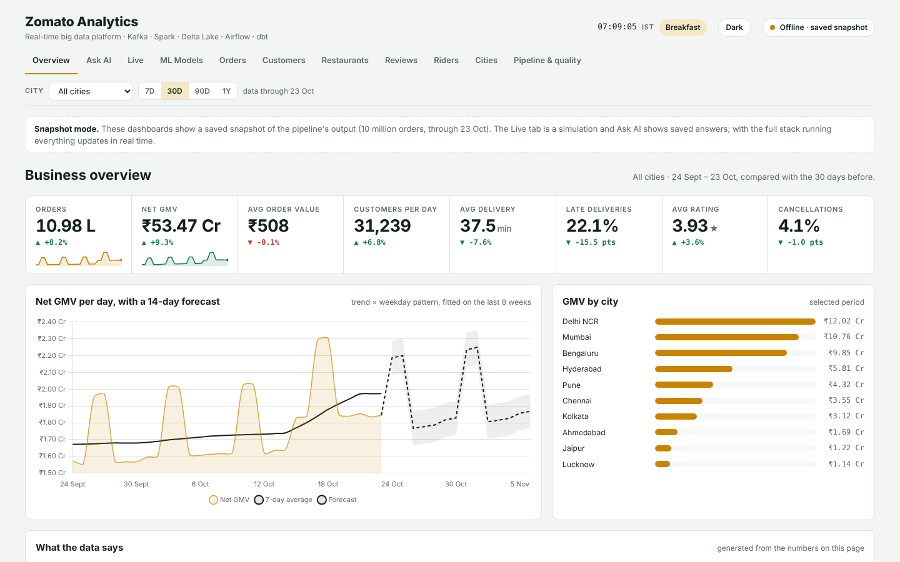
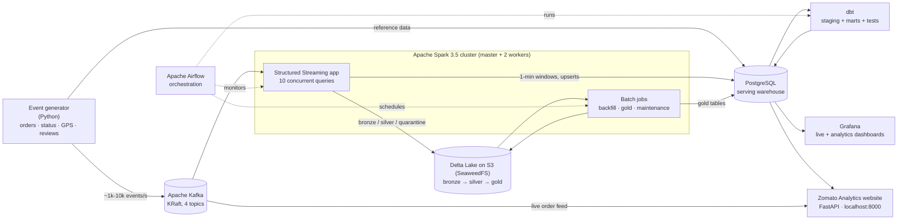
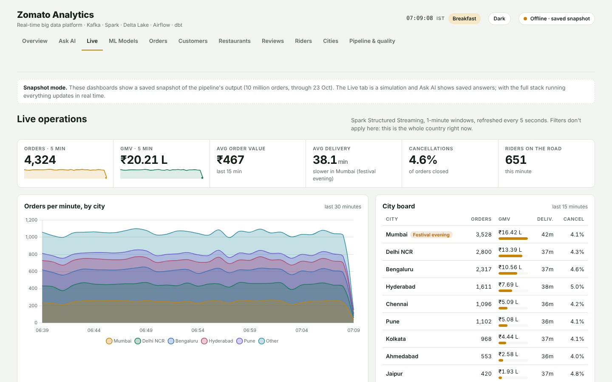
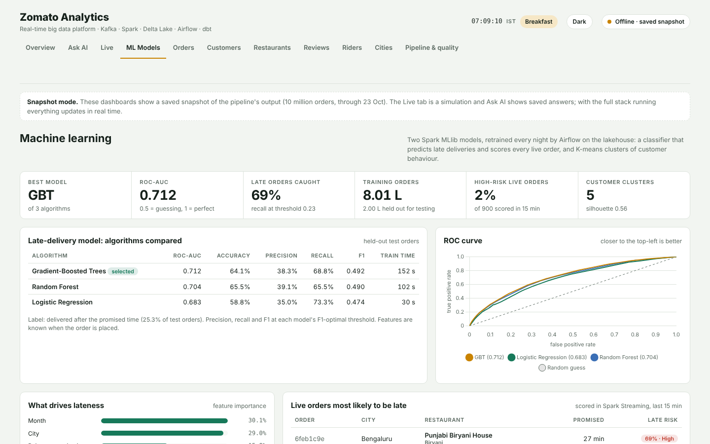
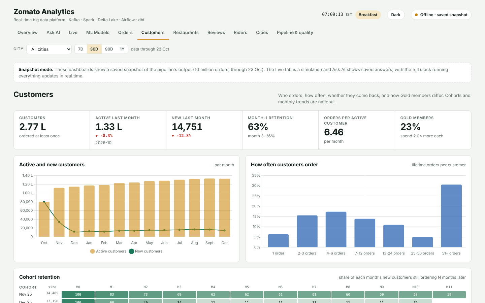
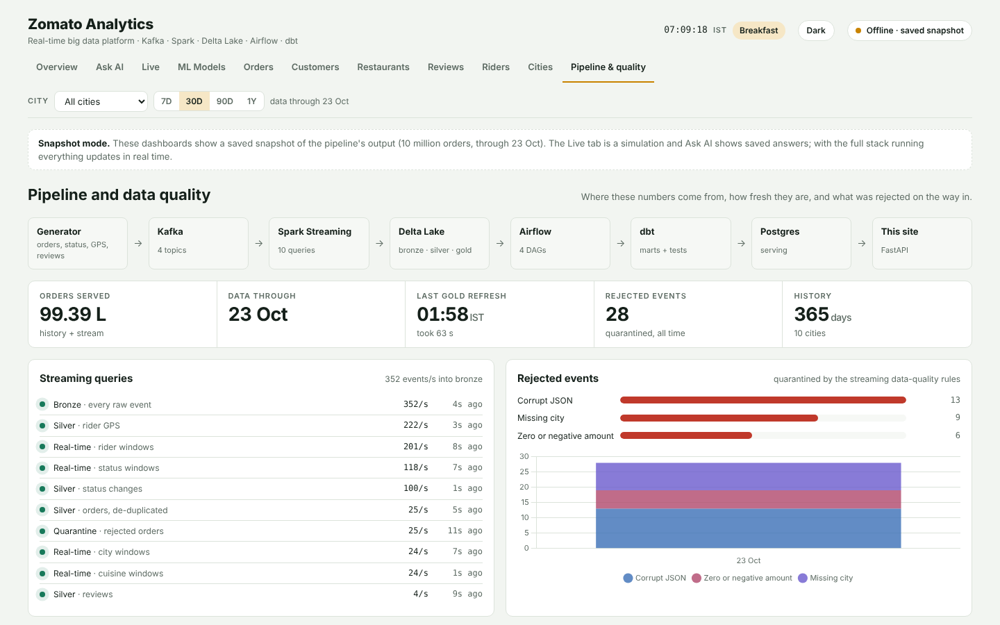

# Zomato Real-Time Lakehouse

**Live demo (saved snapshot):** https://samiyakazi23.github.io/zomato-lakehouse/ · **Team:** Samiya Kazi and Smrithi Pillai (Vidyalankar Institute of Technology, Big Data Analytics mini project)

> An independent student project, not affiliated with or endorsed by Zomato. All orders, customers, restaurants and riders are **simulated** by the project's own event generator, modelled on how an Indian food-delivery marketplace behaves (lunch and dinner peaks, monsoon rain surges, coupons, Gold membership).



An end-to-end big data platform, built to scale to **billions of rows**, for Zomato's food-delivery marketplace that processes orders the way a modern data team would: a real-time event stream, a Delta Lake lakehouse, distributed Spark processing, Airflow orchestration, dbt modelling and live Grafana dashboards. Everything runs on your machine with one command.

```
docker compose up -d --build
```

## Architecture



| Layer | Tool | What it does here |
|---|---|---|
| Ingestion | **Kafka 3.7** (KRaft, no Zookeeper) | 4 partitioned topics: `zomato.orders`, `zomato.order_status`, `zomato.rider_locations`, `zomato.reviews` |
| Stream processing | **Spark Structured Streaming** | Kafka → bronze/silver Delta tables, watermarks, de-duplication, quarantine, 1-minute tumbling-window aggregates upserted into Postgres |
| Storage | **Delta Lake 3.2 on SeaweedFS** (S3 API) | ACID lakehouse with medallion layers, time travel, OPTIMIZE / Z-ORDER / VACUUM |
| Batch processing | **Spark 3.5** standalone cluster | Shuffle-free, resumable generation of up to billions of historical orders; incremental gold layer |
| Orchestration | **Airflow 2.9** | 5 DAGs: backfill, 30-minute batch, streaming health checks, nightly maintenance, nightly ML training |
| Modelling | **dbt 1.12** | Staging views, analytics marts (rolling 7-day GMV, week-over-week growth, rankings), 15 data tests |
| Serving / BI | **PostgreSQL 16 + Grafana 11** | 23-panel dashboard refreshing every 5 s |
| Website | **FastAPI + Chart.js** ("Zomato Analytics") | The project's own analytics site at `localhost:8000`: 9 dashboards with city and period filters (see below) |
| Ops UIs | Kafka UI, Spark UI, SeaweedFS file browser | Inspect topics, jobs and lake files |

## The website: Zomato Analytics

| Live operations | ML models |
|---|---|
|  |  |
| **Customers (cohorts, RFM)** | **Pipeline & data quality** |
|  |  |

The [live demo](https://samiyakazi23.github.io/zomato-lakehouse/) is the same site (`docs/` is a copy of `web/`) running on a saved snapshot of the pipeline's output: 10 million orders. With the full stack running it updates in real time.

Open **http://localhost:8000**. Every tab can be filtered by city and by period (7 days, 30 days, 90 days, 1 year), with changes shown against the previous period.

| Tab | What's on it |
|---|---|
| **Ask AI** | Type a question in plain English. A language model writes the SQL, it runs **read-only** against the warehouse, and you get the answer, a table and an automatic chart. Plus an AI digest of the latest reviews from Kafka |
| **Overview** | 8 headline KPIs with period-over-period change, net GMV per day with a **14-day forecast** (trend × weekday seasonality), GMV by city, cuisine share, weekday pattern, and **auto-generated insights** (fastest-growing city, peak hour, cost of late food on ratings, Gold premium, coupon cost, retention, weekend uplift) |
| **Live** | Real-time KPIs, orders per minute by city, city board with rain-surge flags, order lifecycle funnel, live order and review feeds tailed straight from Kafka |
| **Orders** | Delivered vs cancelled per day, weekday × hour heatmap, items per order, order value distribution, payment mix, delivery-time histogram, cancellation reasons, coupon performance (cost as % of GMV) |
| **Customers** | Active and new customers per month, **cohort retention triangle**, **RFM segments** (Champions, Loyal, New, Occasional, At risk, Hibernating) with the action a CRM team would take, Gold vs non-member value, order frequency distribution, top customers |
| **Restaurants** | Searchable, sortable leaderboard, cuisine GMV vs rating, partner health (Star / Steady / At risk), price-band and veg analysis, popularity vs rating scatter, and **price & rating change history** from the dbt SCD2 snapshot |
| **Reviews** | Rating distribution, daily average rating, **rating vs lateness**, rating by cuisine, latest reviews from Kafka |
| **Riders** | Fleet size and utilisation, deliveries per rider-day, vehicle comparison, top riders |
| **Cities** | One card per market (click to filter the whole site), city scorecard, hourly demand curves, top cuisine per city |
| **ML Models** | Late-delivery classifier (Logistic Regression vs Random Forest vs Gradient-Boosted Trees): ROC curves, metrics, confusion matrix, feature importance, **live orders scored in real time**; K-means customer clusters with silhouette-based choice of k and comparison to RFM segments |
| **Pipeline & quality** | Architecture, gold refresh time, streaming query throughput and freshness, rejected events by reason, lakehouse table inventory |

### Machine learning (Spark MLlib)

`spark/jobs/ml_models.py`, run nightly by the Airflow DAG **`zomato_ml_training`** (and automatically after the first backfill):

* **Late-delivery prediction (classification).** Predicts, when an order is placed, whether it will arrive after the promised time. Features: city, cuisine, hour, weekday, month, rainy season, peak hour, restaurant prep time and rating, basket size and value, Gold, coupon, platform, payment method. Logistic Regression, Random Forest and Gradient-Boosted Trees are trained on the same 80/20 split (1 million sampled delivered orders by default) and compared by ROC-AUC; the best is saved to `lakehouse/models/late_delivery`.
* **Live scoring.** The streaming query `rt_late_risk` loads that model and scores every new order from Kafka within seconds, writing the probability and a High/Medium/Low risk band to `realtime.order_risk` (shown on the ML Models tab).
* **Customer clustering (K-means).** Built from the gold customer aggregate, on recency, tenure, orders, spend, order value and Gold membership (standardised, log-scaled). k from 3 to 8 is compared with the silhouette score, clusters are named from their centroids, and they are compared with the rule-based RFM segments.

Results land in the Postgres schema `ml` (`late_model_metrics`, `late_feature_importance`, `late_roc_curve`, `late_by_city`, `customer_clusters`, `cluster_k_selection`, `cluster_vs_rfm`). A quality gate fails the DAG if the selected model's ROC-AUC is below 0.6.

### Turning on the AI (Groq API)

The Ask AI tab uses the **Groq API** with Llama 3.3 70B (fast, and nothing runs on your laptop).

1. Create a free API key at [console.groq.com/keys](https://console.groq.com/keys).
2. Open `.env` and set `AI_API_KEY=` to your key (keep `AI_BASE_URL=https://api.groq.com/openai/v1` and `AI_MODEL=llama-3.3-70b-versatile`).
3. Restart the website: `docker compose -f docker-compose.lite.yml up -d web`. The Ask AI tab shows the model name in green when connected.

Any other OpenAI-compatible service also works by changing the three `AI_` values.

**Safety:** generated SQL must be one `SELECT`/`WITH` statement, write and admin commands and system catalogs are refused, and it runs as the read-only `grafana` login in a read-only transaction, with a 5-second timeout and a 200-row cap. If a query fails, the model gets one retry with the database error. The SQL is always shown so you can check it.

The analytics tabs read one cached endpoint (`/api/history`) that returns city-level aggregates, so filtering is instant in the browser. If the API isn't reachable, the page falls back to a bundled snapshot (`web/demo/history.json`) produced by this pipeline.

## Pick a mode for your machine

| Mode | Command | Docker memory | Disk | What you get |
|---|---|---|---|---|
| **Lite** (most laptops, 8 GB) | `docker compose -f docker-compose.lite.yml up -d --build` | 5–6 GB | ~12 GB | Everything except Grafana and Kafka UI; Spark in one container; 1M-order history; 15 orders/sec live |
| **Standard** (16 GB) | `docker compose up -d --build` | 12 GB | ~40 GB | Spark cluster (master + 2 workers), Grafana, Kafka UI; 5M-order history |
| **Big data** (32 GB workstation) | `make bigdata` | 20 GB | 150 GB | 3 Spark workers, billion-order history, ~700M events/day |

Lite mode runs the same code (Kafka, Spark Structured Streaming, Delta Lake, Airflow, dbt, the 9-tab website). Only the scale changes.

### In VS Code

Open the folder in VS Code, then **Terminal → Run Task… → Start project (Lite)**. Other tasks: Stop project, Show status, Watch live orders, Delete everything. Docker Desktop must be running.

**No room on your laptop?** Push the folder to a GitHub repo and open it in **GitHub Codespaces** (Code → Codespaces → Create). The included `.devcontainer` asks for a 4-core / 16 GB machine with Docker inside; run the same task there and the website opens in your browser. Free GitHub accounts include a monthly Codespaces allowance that larger machines use up faster, so stop the codespace when you're done.

### On a Mac (no Linux needed)

1. Install **Docker Desktop for Mac** from docker.com (pick Apple chip or Intel chip). Open it once and let it finish starting.
2. Docker Desktop → **Settings → Resources**: set Memory to **6 GB** for Lite (12 GB for Standard). Apply & restart.
3. Unzip the project (double-click the zip), then open **Terminal** and run:
   ```bash
   cd ~/Downloads/zomato-lakehouse
   docker compose -f docker-compose.lite.yml up -d --build
   ```
4. Open **http://localhost:8000**. The live tab fills after ~2 minutes, the analytics tabs after ~10 (Airflow runs the backfill first).

Stop it when you're done (data is kept): `docker compose -f docker-compose.lite.yml stop`. Free the disk completely: `docker compose -f docker-compose.lite.yml down -v` and then `docker system prune -a`.

## Requirements

- **Docker Desktop** (Windows / macOS) or Docker Engine + Compose v2 (Linux)
- **12 GB RAM allocated to Docker** (16 GB machine recommended). In Docker Desktop: Settings → Resources → Memory.
- **~10 GB free disk** to start. Left streaming for days it grows to ~40 GB (3-day retention on the firehose tables), and a billion-row history adds ~23 GB
- Internet access on the first build (images and Maven jars are downloaded once, ~4 GB)

## Quick start

```bash
cd zomato-lakehouse
docker compose up -d --build        # or: make up
```

Then open **http://localhost:8000**, the project's own website.

The first build takes 10–20 minutes. After that, startup takes about a minute. Here's what happens on its own:

| Time after start | What you'll see |
|---|---|
| ~1 min | Generator loads 20k restaurants, 200k customers and 30k riders into Postgres, then starts streaming |
| ~2 min | Spark streaming app joins the cluster; the **Live operations** row in Grafana starts moving |
| ~3 min | Airflow runs `zomato_historical_backfill`: Spark generates **5 million** historical orders across 365 days |
| ~10 min | Backfill triggers `zomato_lakehouse_batch`: gold tables, then dbt marts. The **Lakehouse analytics** row fills in |
| every 30 min | Batch pipeline refreshes gold + marts with the latest streamed data |
| every 5 min | Health DAG checks the streaming app is alive and fresh |

Check everything is healthy:

```bash
bash scripts/smoke_test.sh          # or: make smoke
```

## Where to look

| UI | URL | Login |
|---|---|---|
| **Zomato Analytics (the project website)** | http://localhost:8000 | |
| **Grafana dashboard** | http://localhost:3000 | admin / admin |
| **Airflow** | http://localhost:8080 | admin / admin |
| Spark master | http://localhost:9090 | |
| Spark streaming app (jobs, SQL, streaming tab) | http://localhost:4040 | |
| Kafka UI (topics, messages, consumer lag) | http://localhost:8085 | |
| Lake file browser (the data lake files) | http://localhost:8888/buckets/lakehouse/ | |
| Postgres | `localhost:5433`, db `zomato` | zomato / zomato |

## Billion-scale mode

The default start is deliberately light (5M historical orders) so it boots on any 16 GB laptop. The platform itself is built for billions:

```bash
make billion          # 1,000,000,000 historical orders on the default stack
# or the full profile: more Spark workers, 10x dimensions, 4 generator processes
make bigdata && make billion
```

Measured on a 2-core / 7 GB machine (your laptop will usually be faster):

| What | Measured | 1 billion orders |
|---|---|---|
| Backfill throughput | ~36,000 orders/s **per Spark core** (73k/s on 2 cores) | ~2–4 h with 2–6 cores |
| Storage | ~23 bytes per order (Parquet + zstd, one ~40–250 MB file per day) | **~23 GB** |
| Gold refresh (every 30 min) | 40M orders served in under 50 s | same: cost doesn't grow with history |
| Streaming events | ~150 bytes per event (bronze + silver) | 1B events ≈ 150 GB, so retention is on |

How it stays fast at that size:

- **Shuffle-free generation.** Each Spark partition is exactly one day, exploded from a tiny plan of `(day, slice)` rows. Every dimension join is a broadcast. Nothing is sorted or shuffled, so memory stays flat and time scales linearly with rows ÷ cores.
- **Month-by-month and resumable.** History is written one calendar month at a time with dynamic partition overwrite, and each finished month is recorded in `silver/_backfill_log`. If your laptop sleeps or a container restarts, Airflow retries and it carries on from the next month. Pass `"resume": false` to start over.
- **Aggregate at ingest.** Each month also produces compact *additive* daily aggregates (`gold/hist_agg_*`: sums and counts, never averages). The 30-minute gold job reads those few million rows plus only the **last 2 days** of streamed data (`gold/stream_agg_*`) and combines them with a SUM. It never rescans the billion-row table.
- **Bounded streaming storage.** The streaming app deletes bronze and GPS-ping partitions older than `BRONZE_RETENTION_DAYS` / `RIDER_PINGS_RETENTION_DAYS` (default 3) and vacuums them. Orders, statuses and reviews are kept forever.

### Billions through the live stream

At the default 50 orders/sec the stream produces ~1,000 events/sec, about **86 million events a day**. To push the real-time path harder:

| Setting | Events/sec | Events/day | Needs |
|---|---|---|---|
| default | ~1k | ~86M | default stack |
| `ORDERS_PER_SEC=200` | ~4k | ~350M | default stack |
| `make bigdata` (400/s, 4 processes) | ~8k | **~700M** | ~20 GB Docker RAM, 10+ cores |
| bigdata + `ORDERS_PER_SEC=1000`, `GENERATOR_PROCESSES=8` | ~20k | **~1.7B** | a workstation (16+ cores) |

One Python process tops out at roughly 10–20k events/sec, which is why `GENERATOR_PROCESSES` exists. Spark streaming throughput scales with `SPARK_CORES_MAX` on the `spark-streaming` service. Watch the "Pipeline throughput" panel: if input rows/sec keeps falling behind what the generator logs, add cores.

### Disk budget

| Profile | History | Streaming (steady state with retention) | Free disk to have |
|---|---|---|---|
| default | ~0.1 GB | ~40 GB at 1k events/s | 60 GB |
| `make billion` | ~23 GB | ~40 GB | 80 GB |
| `make bigdata` + billion | ~23 GB | ~100 GB (2-day retention) | 150 GB |

Lower `BRONZE_RETENTION_DAYS` / `RIDER_PINGS_RETENTION_DAYS` or `ORDERS_PER_SEC` if space is tight. `make size` shows the current lake size and how many orders are being served.

## Other knobs

| Knob | How |
|---|---|
| History size | `make backfill ORDERS=50000000 DAYS=730`, or in Airflow *Trigger DAG w/ config* on `zomato_historical_backfill` with `{"orders": 50000000, "days": 730}` |
| Dimension sizes | `NUM_RESTAURANTS`, `NUM_CUSTOMERS`, `NUM_RIDERS` in `.env`. For a billion orders use ~10x (the bigdata profile does this) so riders don't do 90 deliveries a day. |
| More Spark capacity | Copy a `spark-worker-*` block to add workers, then raise `SPARK_CORES_MAX` (total for the app) and `SPARK_EXECUTOR_CORES` (per executor ≤ cores per worker) |

## How the data works

**The event generator** (`generator/`) models the marketplace realistically:

- Orders follow the Indian lunch (12–2 pm) and dinner (7–10 pm) peaks in IST, weighted by city (Delhi NCR, Mumbai and Bengaluru lead)
- Every order runs a full lifecycle: `ACCEPTED → PREPARING → RIDER_ASSIGNED → PICKED_UP → DELIVERED` (or `CANCELLED` by the restaurant or the customer)
- Riders emit GPS pings every 3 s while travelling from restaurant to customer, which makes this the highest-volume topic
- **Seasonal weather:** heavy rain only hits a city in its real rainy season (southwest monsoon June to September, strongest in Mumbai; Bengaluru's wet October; Chennai's northeast monsoon October to December). Rain raises demand by 60%, adds about 12 minutes to deliveries and increases cancellations. On dry days the spikes are cricket match nights, festival evenings and long weekends instead. Active events are written to `realtime.city_events` and labelled on the Live tab.
- Gold members get free delivery, coupons cap discounts, ratings drop when food arrives late
- History has a **customer lifecycle**: a loyal core orders all year, new customers sign up steadily, most stay for about 45 days and some for about 8 months. Cohort retention therefore falls the way it does in real apps. The customer base scales with history size (about 30 orders per customer per year), with generated IDs beyond the named customers in `dims.customers`.
- Lifecycles are time-compressed (about a minute in real time) but carry realistic `delivery_minutes`, so dashboards move fast and still show believable numbers
- **~1% of orders are deliberately dirty:** duplicates, null cities, negative amounts, late events, corrupt JSON

**Medallion layers** (all Delta tables in `s3a://lakehouse`):

| Layer | Tables | Notes |
|---|---|---|
| Bronze | `bronze/events` | Every raw Kafka message, partitioned by topic and date. The replayable source of truth. |
| Silver | `silver/orders`, `order_status`, `rider_locations`, `reviews` | Parsed and typed. Orders de-duplicated with `dropDuplicatesWithinWatermark` (10-min watermark). |
| Silver (history) | `silver/orders_historical` | Up to billions of rows, one file per day, partitioned by `order_date` |
| Quarantine | `silver/quarantine_orders` | Rejected rows with a `dq_reason`, surfaced on the dashboard |
| Gold | `gold/hist_agg_*`, `gold/stream_agg_*` → 6 serving tables | Additive daily aggregates from history and stream, combined; exactly-once de-duplication of streamed orders |

**Lambda-style serving:** the streaming 1-minute windows are fast but approximate (late events beyond the 2-minute watermark are dropped). The batch gold layer recomputes the exact numbers every 30 minutes. You get both freshness and correctness.

## dbt project

`dbt build` (run by Airflow every 30 minutes) builds staging views, analytics marts and runs 40+ tests. Highlights:

- **SCD Type 2 snapshot** (`snapshots/snap_restaurants.sql`): the generator revises a few restaurants' prices and ratings every 10 minutes; the snapshot closes the old row and opens a new one, so `mart_restaurant_changes` can answer "who raised prices this week?" or "what did this restaurant cost in March?".
- **Incremental model** (`mart_kpi_history`): each run reprocesses only the last 3 days (`delete+insert` on `order_date, city`) instead of rebuilding the table; a test guarantees no city-day is ever duplicated.
- **Cohorts, RFM segments, rating drivers, rankings** with accepted-values and range tests.

## Airflow DAGs

| DAG | Schedule | Tasks |
|---|---|---|
| `zomato_historical_backfill` | once on start (re-run with config) | wait for reference data → Spark generates history month by month (resumable, 5 retries) → trigger batch |
| `zomato_lakehouse_batch` | every 30 min | incremental Spark gold → `dbt build` (models + tests) → data-quality gate → `dbt docs generate` |
| `zomato_streaming_health` | every 5 min | Spark app running? all 10 queries committing? real-time windows fresh? |
| `zomato_lakehouse_maintenance` | 03:00 IST | Delta OPTIMIZE (aggregate tables) + VACUUM → prune old real-time rows |

A `spark_pool` with one slot serialises Spark batch jobs so they never starve the always-on streaming application.

## Project layout

```
zomato-lakehouse/
├── docker-compose.yml          14 services
├── docker-compose.bigdata.yml  billion-scale overlay (3 workers, bigger dims, 4 producers)
├── .env                        every tunable setting
├── docker/                     Dockerfiles (Spark w/ baked-in jars, Airflow w/ Java+PySpark+dbt, generator)
├── generator/                  order event generator → Kafka
├── spark/jobs/
│   ├── streaming_pipeline.py   10 streaming queries + throughput listener
│   ├── historical_backfill.py  billion-scale, shuffle-free, resumable history generator
│   ├── aggregates.py           additive daily aggregates shared by backfill and gold
│   ├── gold_aggregates.py      incremental gold layer + serving tables
│   ├── delta_maintenance.py    OPTIMIZE / VACUUM
│   ├── common.py, schemas.py   shared config, Spark session, event schemas
│   └── submit.sh               spark-submit wrapper (client mode)
├── airflow/dags/               4 DAGs
├── dbt/zomato/                 staging + marts + tests
├── postgres/init/              warehouse schemas and tables
├── grafana/                    datasource + dashboard provisioning
├── web/                        Zomato Analytics website: FastAPI API, AI layer (ai.py), 10-tab frontend, demo snapshot
└── scripts/smoke_test.sh       end-to-end health check
```

## Useful commands

```bash
make logs                         # follow generator + streaming logs
make psql                         # SQL shell on the warehouse
make gold                         # run the batch pipeline now
make billion                      # 1B historical orders (resumable)
make size                         # lake size + orders served
docker compose logs -f airflow-scheduler
docker compose restart spark-streaming   # resumes from its checkpoints, no data loss
make down                         # stop (data is kept)
make clean                        # stop and delete ALL data
```

Example warehouse queries:

```sql
-- live: orders per city in the last 5 minutes
SELECT city, sum(orders) FROM realtime.city_orders_1m
WHERE window_start > now() - interval '5 minutes' GROUP BY 1 ORDER BY 2 DESC;

-- analytics: fastest-growing cities week over week
SELECT city, order_date, gmv, wow_growth_pct FROM analytics.mart_city_kpis
WHERE order_date = (SELECT max(order_date) - 1 FROM analytics.mart_city_kpis) ORDER BY wow_growth_pct DESC;
```

## Troubleshooting

| Symptom | Fix |
|---|---|
| Containers restarting, exit code 137 | Docker is out of memory. Give it 12 GB, or stop `kafka-ui` (`docker compose stop kafka-ui`). |
| Port already in use | Change the left-hand port in `docker-compose.yml` (for example `"3001:3000"`) |
| Grafana / website live panels empty | Give it ~2 min after start, then check `docker compose logs spark-streaming` |
| Website says "Offline · saved snapshot" | The page couldn't reach its API. Open it at http://localhost:8000 (not as a local file) and check `docker compose logs web` |
| Analytics panels empty | The backfill is still running. Watch it in Airflow → `zomato_historical_backfill`. |
| `submit.sh: $'\r': command not found` (Windows) | The file got CRLF line endings. Run `git config core.autocrlf false` and re-extract, or convert `spark/jobs/submit.sh` to LF in your editor. |
| Health DAG red in the first minutes | Expected until the streaming app's first batches land; it retries automatically |
| Disk filling up | Lower `ORDERS_PER_SEC` or the retention days in `.env`, or `make clean` to reset everything |
| Billion backfill stopped part-way | Nothing is lost. Clear the failed task in Airflow (or `make billion` again) and it resumes from the next unfinished month. |
| Backfill executor lost / OOM | Raise `SPARK_EXECUTOR_MEMORY` for `airflow-scheduler`, or use `"months_per_chunk": 1` (the default) |
| `pull access denied for minio/minio` | You have an old copy of the project. MinIO removed its free images in September 2026; this version uses SeaweedFS instead. Download the latest zip. |

## Extending it

- Add **Trino** + a Hive/Iceberg catalog to query the lake with SQL directly
- Swap Postgres for **ClickHouse** or **Apache Pinot** for sub-second OLAP on raw events
- Add **Great Expectations / Soda** checks as Airflow tasks
- Add RAG over review text so the AI can quote real customer comments
- Add a **Schema Registry** with Avro instead of JSON
